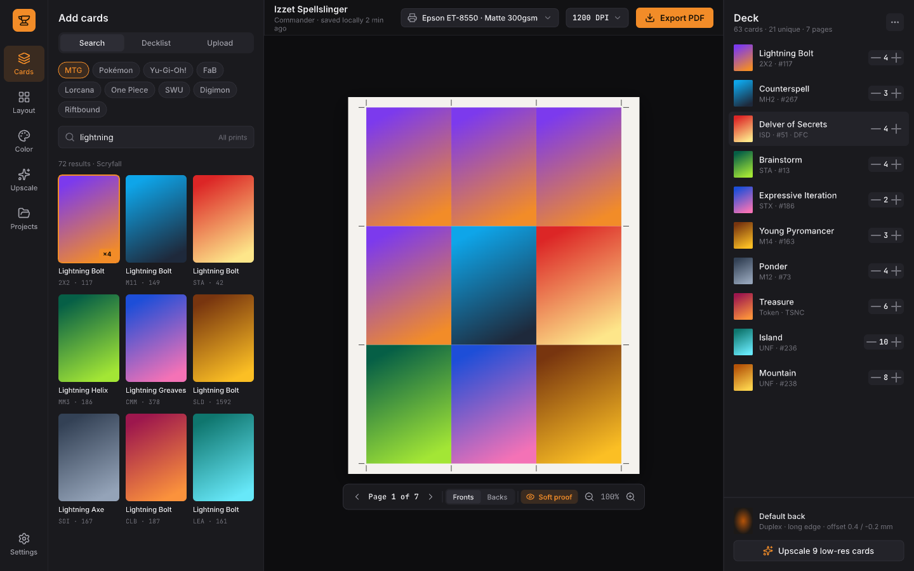

# ProxyForge

Open-source desktop app for printing proxy cards of trading card games at home or at a print shop. It runs on macOS, Windows and Linux, works offline, has no ads, no account and no tracking, and every feature is free.



## Features

- **Card banks for 9 games**: Magic: The Gathering (Scryfall), Pokémon (TCGdex), Yu-Gi-Oh! (YGOPRODeck), Flesh and Blood (the-fab-cube dataset), Lorcana (Lorcast), One Piece (OPTCG API), Star Wars: Unlimited (SWU-DB), Digimon (digimoncard.io) and Riftbound (Riftcodex, beta). Search all printings, double-faced cards and tokens. Images are cached locally, so a deck works offline after the first download.
- **Decklist import**: MTGA/MTGO/Moxfield text, PTCGL lists, Yu-Gi-Oh! `.ydk`, MPC Autofill XML, and Archidekt or Moxfield links.
- **Your own art**: drag and drop PNG, JPG, WebP, TIFF or AVIF files. Built-in bleed, including the MPC 1/8″ size, is detected automatically.
- **Layout engine**: Letter, Legal, Tabloid, A4, A3, A3+, 12×12 or a custom page. Portrait or landscape, margins, spacing, auto or manual grid, and any card size. Standard, Japanese/Yu-Gi-Oh!, mini, tarot and custom presets are included.
- **Bleed**: 0–10 mm, generated by edge extension, mirroring or solid colour.
- **Cut guides**: crop marks, full lines or corner marks, with adjustable colour and thickness.
- **Duplex**: long-edge or short-edge flip, X/Y offset calibration and a printable calibration sheet.
- **Cutting machines**: Silhouette Cameo Type 1 registration marks, plus SVG and DXF cut files with rounded corners.
- **Colour management (Little CMS)**: print profiles combine a printer or paper ICC profile, rendering intent, black point compensation, optional profile embedding and an ink limit. Adjustments cover brightness, contrast, saturation, vibrance, gamma, levels, per-channel balance, RGB curves and sharpening. The preview offers a live soft proof with a gamut warning, and you can print a colour test chart.
- **CMYK output**: CMYK PDFs carry a PDF/X output intent, and TIFF files can be CMYK. Use any CMYK ICC profile, for example the free FOGRA/PSO profiles from ECI, or the built-in uncalibrated generic CMYK.
- **AI upscaling, local**: the bundled Real-ESRGAN models (x4plus, x4plus-anime, AnimeVideo v3) run on the GPU through Vulkan or MoltenVK, with a CPU fallback. Scale ×2, ×4, ×8 or ×16, automatically only for cards below the target DPI. Results are cached, you choose which cards to process, cards can be upscaled again while they are still below the target, and you can revert any card.
- **Very high resolution**: export at 300 to 4800 DPI. PDF output is lossless (Flate) or JPEG. PNG and TIFF pages can be 8 or 16 bits per channel. You can also export a ZIP of processed card images. Large pages are written in streamed strips, so memory use stays low.
- **Live page view**: every page in one scrollable column, refreshed in real time as you edit (an instant low-resolution pass, then a sharp one). Trackpad: pinch to zoom around the cursor and two-finger scroll to pan. Mouse: Ctrl/⌘ + wheel to zoom and drag to pan. Keyboard: ⌘+ / ⌘− / ⌘0, and double-click to toggle 200%. Sheets that would print nothing (such as empty back pages) are hidden. Click a card on the sheet to open it, or drag a copy onto another slot to move it. Press F for a focus view that hides every panel except the sheet.
- **Card details**: one dialog per card with its settings, the other prints of the same card from its bank, and its image versions (original and upscaled). Any deck card can be used as the back of other cards or as the default back.
- **Direct printing**: choose a system printer and print at 100% scale with copies, page ranges and duplex (CUPS on macOS and Linux; on Windows the PDF is handed to the default PDF app).
- **Workspace**: resizable side panels, drag to reorder the deck list and one-click deck clearing (undoable).
- **Projects**: unlimited projects, autosave, undo/redo, layout presets and `.pforge` bundles for sharing a project with its art.
- **Languages**: English and Português (Brasil).

## Install

Download the installer for your system from [Releases](https://github.com/matheuscassiano/proxyforge/releases):

| OS | File |
|---|---|
| macOS (Apple Silicon and Intel) | `ProxyForge_x.y.z_universal.dmg` |
| Windows 10/11 | `ProxyForge_x.y.z_x64-setup.exe` or `.msi` |
| Linux | `.AppImage`, `.deb` or `.rpm` |

On macOS the build is not notarized. After the first launch is blocked, open **System Settings → Privacy & Security** and click **Open Anyway**, or run:

```bash
xattr -dr com.apple.quarantine /Applications/ProxyForge.app
```

## Build from source

Requirements: [Rust](https://rustup.rs) (stable), Node.js 20+, pnpm and the [Tauri prerequisites](https://tauri.app/start/prerequisites/) for your OS.

```bash
pnpm install
```

```bash
pnpm fetch:upscaler
```

```bash
pnpm tauri dev
```

`pnpm fetch:upscaler` downloads the Real-ESRGAN executable and models for your OS into `src-tauri/resources`. They are not stored in git.

To build installers:

```bash
pnpm tauri build
```

Tests:

```bash
pnpm test
```

```bash
pnpm test:rust
```

The live test against all nine card APIs is opt-in:

```bash
cd src-tauri && cargo test --lib live_banks -- --ignored --nocapture
```

## How it works

| Area | Where |
|---|---|
| Page geometry, bleed boxes, cut marks, duplex mirroring, registration marks | `src-tauri/src/layout.rs` |
| Bleed detection, crop, Lanczos3 resampling, bleed generation (16-bit) | `src-tauri/src/imaging.rs` |
| Adjustments, ICC transforms, CMYK, ink limit, soft proof | `src-tauri/src/color.rs` |
| PDF / PNG / TIFF / ZIP writers, cut files, test chart, preview | `src-tauri/src/render.rs` |
| Card banks with rate limiting and caching | `src-tauri/src/providers.rs` |
| Decklist parsers | `src-tauri/src/import.rs` |
| Real-ESRGAN runner | `src-tauri/src/upscale.rs` |
| Local storage (projects, images, profiles, `.pforge`) | `src-tauri/src/store.rs` |
| UI (React + Tailwind) | `src/` |
| UI design (Pencil exports) | `design/` |

The preview uses the same Rust pipeline as the export, so what you see is what prints. With soft proof on, the preview also simulates your print profile.

## Data and privacy

Everything is stored in your app data folder (shown in **Settings**). The app only connects to the card banks you search, and to Archidekt or Moxfield when you paste a link. It sends no telemetry.

## License

GPL-3.0-or-later. See [LICENSE](LICENSE). Bundled third-party components: Real-ESRGAN ncnn-vulkan (MIT) and its models (BSD-3-Clause), and Little CMS (MIT).

See [DISCLAIMER.md](DISCLAIMER.md) for the intended use of card images.
